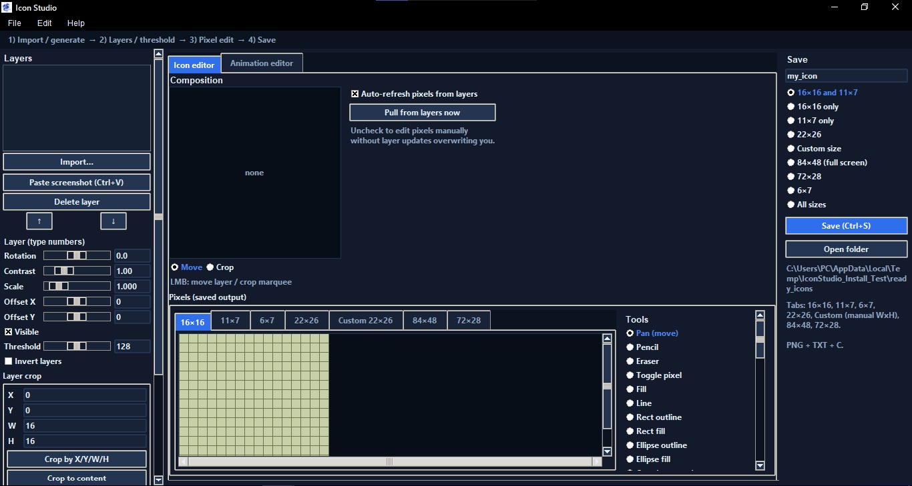
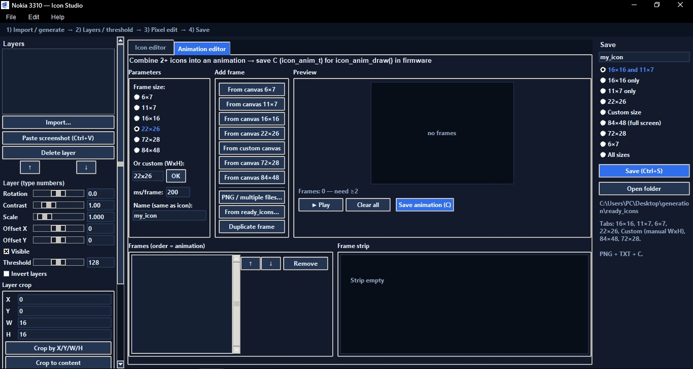

# Monochrome Icon Studio

  

  <strong>A tool concept for creating and editing icons and animations for monochrome displays.</strong>

Monochrome Icon Studio is a software project focused on creating and editing pixel-based graphics for monochrome displays with different resolutions.

The goal is to provide a dedicated workspace for designing icons and animations that can be adapted to the display dimensions and visual limitations of embedded devices.

Developed by **Azure Dragon Tech**.

## Screenshots

### Icon Studio — Preview 1

### Icon Studio — Preview 2

## About the Project

Monochrome displays are widely used in embedded electronics, retro-inspired devices, small instruments, and custom hardware projects.

Creating graphics for these displays requires careful control over individual pixels, display resolution, and the limitations of monochrome output.

Monochrome Icon Studio aims to make this process more convenient by providing a dedicated environment for working with icons and animations.

## Project Goals

- Create and edit icons for monochrome displays.
- Design pixel-based graphics for different display resolutions.
- Prepare graphics for devices with limited display capabilities.
- Create and edit animation frames.
- Support workflows for retro electronics and embedded projects.
- Provide a practical tool for custom display graphics.

These items describe the project's intended direction. Specific functionality depends on the current implementation.

## Potential Applications

- Retro-inspired electronics
- Embedded systems and microcontroller projects
- Custom monochrome display interfaces
- Small screens in portable devices
- Experimental hardware projects
- Pixel-art icons and animations

## Development Status

**Status: In development**

The project is intended to evolve as features are implemented and tested.

Supported resolutions, image formats, animation capabilities, export options, and hardware compatibility should be documented as they are confirmed.

## Getting Started

Installation and launch instructions will be added when the current distribution method and software requirements are documented.

Please check the repository for the latest source code, available releases, and development updates.

## Roadmap

- [ ] Develop the icon editing workflow
- [ ] Improve support for different monochrome display resolutions
- [ ] Develop animation editing tools
- [ ] Document supported image formats
- [ ] Document export options
- [ ] Test graphics with target display hardware
- [ ] Publish usage instructions and examples

## Contributing

Feedback, suggestions, and bug reports are welcome.

If you have ideas for improving the workflow or supporting additional monochrome displays, feel free to open an issue in the repository.

Please describe proposed changes clearly and include screenshots or examples where useful.

## Support the Project

If you find this project interesting and would like to support its development, you can visit my Ko-fi page:

[**☕ Support Azure Dragon Tech on Ko-fi**](https://ko-fi.com/jerydgreen)

Your support helps fund independent development, testing, documentation, and future improvements.

Thank you for your interest and support!

## Disclaimer

Monochrome Icon Studio is an independent software project developed by Azure Dragon Tech.

Compatibility with specific displays and devices should not be assumed unless explicitly documented and tested.

---

**Made by Azure Dragon Tech.**
